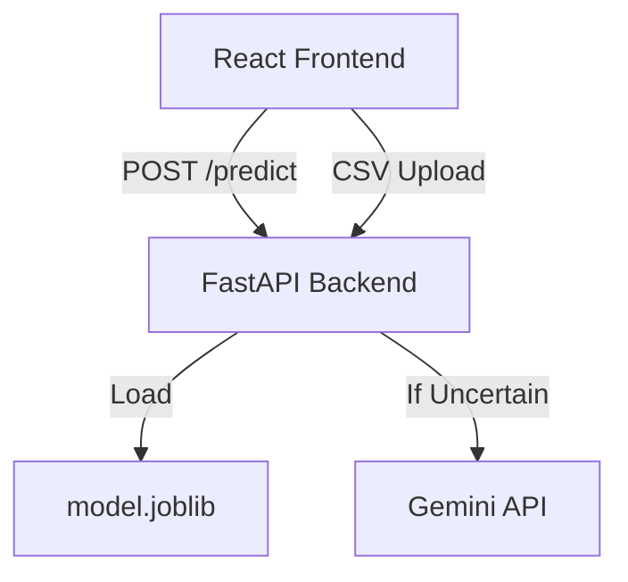

# SMS Spam Classifier Enhancement

This project aims to improve your existing SMS spam classifier by refining preprocessing techniques, expanding feature engineering, comparing multiple machine learning models, and deploying the solution via a modern FastAPI backend and a responsive React frontend.

## User Review & Critical Decisions

> [!IMPORTANT]
> The backend will be implemented in Python using FastAPI. Deployment will be external (e.g., Hugging Face Spaces or Render). The Gemini API will be utilized to provide classifications when the model's confidence is uncertain.

- **Confirmed Decision 1**: Backend framework is FastAPI / Python.
- **Confirmed Decision 2**: Gemini comparison panel will activate only when model confidence is low.

## 1. Overview & Core Concept

- **What It Does**: Classifies SMS messages as 'spam' or 'ham' with high precision and recall, providing confidence levels and optional AI-based validation.
- **Key Value**: Improved accuracy over the baseline, robust preprocessing, explainable results, and a user-friendly interface.

## 2. User Experience & Visual Design

- **Key User Flows**: 
    1. Input SMS in text box.
    2. View prediction, confidence bar, and (if uncertain) Gemini's assessment.
    3. Batch upload CSV for bulk classification with results download.
- **Visual Identity & Theme**: Minimalist, clean dashboard using Shadcn-UI components.
- **Layout**: Single-page application with responsive design, light/dark mode support, and interactive example messages.

## 3. Key Product Decisions & Trade-Offs

- **Preprocessing**: Moving away from blind removal of characters to token-based substitution (URL, EMAIL, etc.) to retain critical features like ALL-CAPS and punctuation.
- **Feature Engineering**: Combining TF-IDF n-grams with handcrafted numeric features (digit ratio, uppercase ratio, etc.) for better context capture.
- **Modeling**: Comparing LinearSVC, Logistic Regression, and Ensemble methods. Using class weighting/SMOTE for class imbalance.

## 4. Technical Architecture

- **Backend**: FastAPI with Pydantic for validation, CORS enabled.
- **Model**: Scikit-learn Pipeline (preprocessing + features + model + threshold).
- **Frontend**: React + Tailwind CSS + Shadcn-UI.
